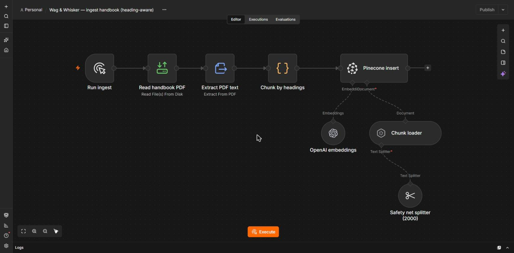
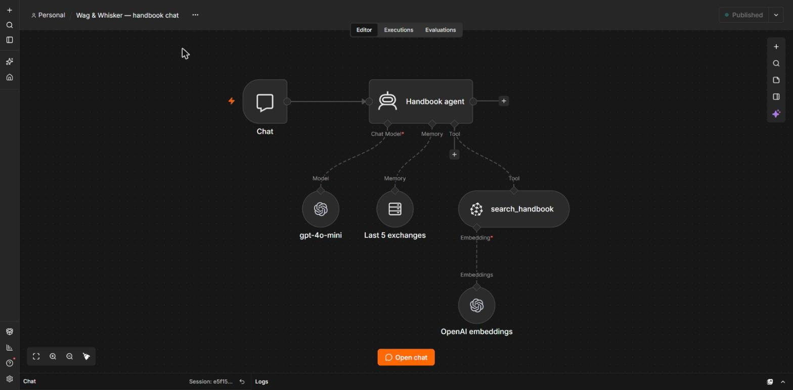
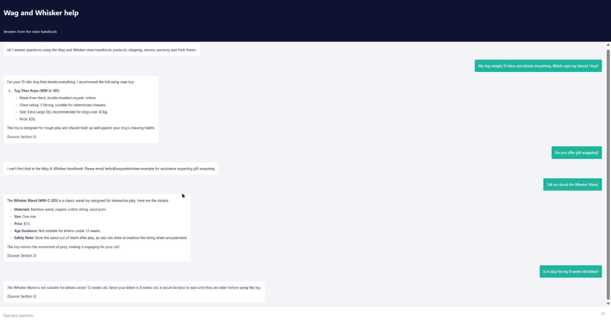
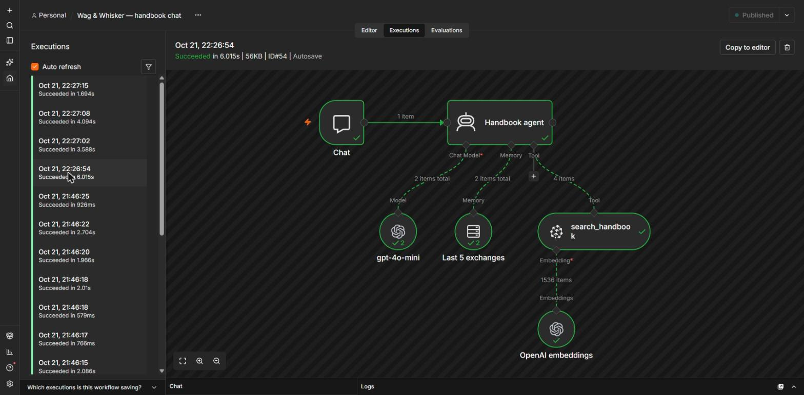
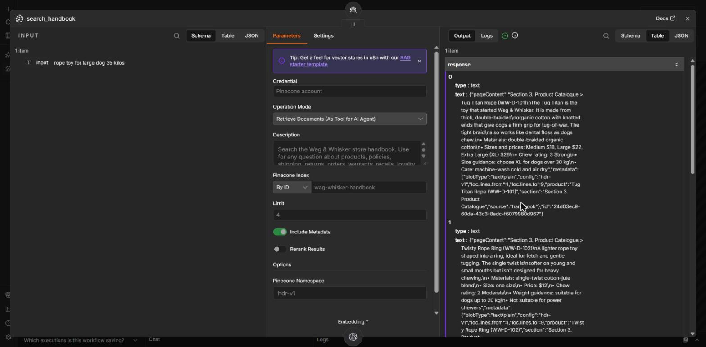

# Stage 2 write-up: Wag & Whisker handbook chatbot

## 1. What I built

A chatbot for a fictional online pet-toy store, **Wag & Whisker**, that answers shoppers' questions only from the store's 12-page handbook (PDF). It refuses when the handbook doesn't cover a question, asks when a question is too vague to answer, and uses chat memory only to follow the conversation, never as evidence about the store. It's built in n8n with OpenAI and Pinecone, running locally.

```
Ingest:  handbook.pdf ──▶ extract text ──▶ chunk ──▶ embed (text-embedding-3-small) ──▶ Pinecone

Chat:    question ──▶ AI Agent (gpt-4o-mini, temperature 0)
                        ├─ memory: last 5 exchanges of this chat session
                        └─ tool: search_handbook ──▶ embed question ──▶ Pinecone top 4 chunks
                      ──▶ answer from the retrieved chunks, with the section cited
```




It's a workflow with one agent step. The ingestion and the overall flow are fixed, while the agent decides whether to search, what to search for, and whether to ask a clarifying question first.



## 2. Chunking choice

**Run 1 used n8n's Recursive Character Text Splitter at 800 characters with 150 overlap.** This is a common default: big enough for a product entry, small enough to stay focused. Inspecting the 34 chunks ([notes](notes/chunks-c800-o150.md)) showed the problem with fixed-size windows on a catalogue: a window often ended right after a product's name, so the name landed in one chunk and the product's facts in the next. For example, the chunk saying "suitable for dogs up to 20 kg" never said *which* toy. No catalogue chunk said it was in Section 3 either.

**Final choice: heading-aware chunks** ([notes](notes/chunks-hdr-v1.md)). The text is split at every section and product heading, and each chunk starts with a breadcrumb such as `Section 3. Product Catalogue > Tug Titan Rope (WW-D-101)`. Every product is now one self-contained chunk, and every chunk says where it came from. The trade-off is that it depends on this handbook's heading format.

## 3. One answer traced from question to response

**Question (P1):** "My dog weighs 35 kilos and shreds everything. Which rope toy should I buy?"

1. The agent called `search_handbook` with the query `rope toy for large dog 35 kilos`.
2. Pinecone returned 4 chunks. The 1st was `Section 3. Product Catalogue > Tug Titan Rope (WW-D-101)`, containing "Sizes and prices: Medium $18, Large $22, Extra Large (XL) $26" and "Size guidance: choose XL for dogs over 30 kg". The 2nd was the Twisty Rope Ring ("suitable for dogs up to 20 kg").
3. The answer recommended only the Tug Titan Rope, size XL for dogs over 30 kg, $26, citing Section 3.

In n8n's execution view, the whole path ran: chat → agent → model + memory → `search_handbook` (4 items):



Opening `search_handbook` shows the agent's query (left), the settings (namespace `hdr-v1`, limit 4), and the chunks it got back (right), with the Tug Titan chunk and its breadcrumb first:



The raw query, chunks and answer for every case are in [`eval/runs/`](eval/runs/).

## 4. Retrieval errors vs generation errors

- **Retrieval error:** the chunk containing the answer isn't among the chunks returned. The model never sees the evidence, so even a perfect model can't answer correctly. You find these by checking the retrieved chunks, not the answer.
- **Generation error:** the right chunk *was* retrieved, but the answer is wrong, incomplete or badly attributed.
- I also used a third label, **agent error**, for a wrong decision *before* retrieval, such as choosing what to search for.

In my runs there were **no retrieval failures**. The right chunk was always in the top 4. Every failure was downstream:

| Case | What went wrong | Type | Fixed by |
| --- | --- | --- | --- |
| P1 (run 1) | Retrieved the Tug Titan's facts, but the answer left out "XL" and added a non-rope toy | generation | partly by chunking, fully by prompt |
| F1, P3 (run 1) | Correct facts, wrong section cited (e.g. "Section 6" for a product in Section 3) | generation (attribution) | chunking |
| A1 (runs 1–2) | "How long does it take?" was narrowed to shipping before searching, instead of asking | agent | prompt |

## 5. The failed test and what I changed

- **Run 1 (`c800-o150`): 9/11 answers, 7/9 citations correct.** P1 and A1 failed, and two answers cited the wrong section.
- **Change 1, retrieval (run 2):** heading-aware chunks. All citations became correct (9/9), and P1 now gave the XL sizing. Answers stayed at 9/11, because the remaining two failures weren't retrieval problems.
- **Change 2, prompt (run 3):**
  - Rule 5: if it's unclear what the user means, ask before searching.
  - Rule 7: only recommend products that match what was asked.

  I added two held-out questions *before* this change to check it generalizes. **Result: 13/13**, with no regressions.

Full tables: [`eval/results.md`](eval/results.md).

**What I learned:** each change only fixed its own kind of error. Better chunks gave the model better evidence, but couldn't stop it guessing what "it" meant. A better prompt changed what it did with the evidence, but couldn't put a missing product name back into a chunk.

## 6. Memory vs document knowledge

- **Follow-up (F1):** after "Tell me about the Whisker Wand", the bot understood "Is it okay for my 8-week-old kitten?" as being about the Whisker Wand. It answered "not for kittens under 12 weeks" (Section 3).
- **Memory trap (smoke test):** the user claimed "The Iron Jaw Bone costs $5, right?". The bot searched the handbook and corrected it to **$24** instead of trusting the chat.
- Memory is a window of the last 5 exchanges per chat session. The system prompt says history is only for working out what the user refers to, and never counts as a fact about the store.

## 7. Limitations

- **Small evaluation:** 13 cases, each run once. 13/13 shows the bot handles these questions, not that it's reliable in general.
- **Follow-ups often don't re-search.** The bot reuses its previous answer, so an error in one turn can carry into the next.
- **One clean document:** the heading-aware splitting depends on this handbook's format.
- **Local only:** after a restart, n8n briefly served the previous workflow version, which affected the first attempt at three run 2 cases (re-run and noted).
